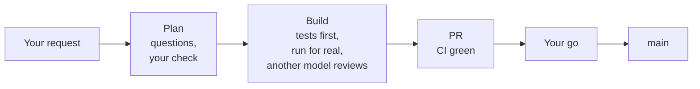

<div align="center">

# Supercharge

**One line in, tested code merged.** A skill bundle for [omp](https://github.com/can1357/oh-my-pi) and [Claude Code](https://code.claude.com).

[](https://github.com/po2studio/supercharge/actions/workflows/check.yml)


[](LICENSE)

</div>

```text
you     /supercharge the settings title is cut off on narrow screens

agent   One ticket. One question (default in brackets):
        wrap the title, or shorten it with an ellipsis? [wrap]
        Plan: let the title wrap, add a test at 360px wide.

you     go

agent   Built tests first, run in the browser, reviewed by a different model.
        PR #42 into main, CI green. Reply go to merge.

you     go
```

## What it is

Five skills that take a request from one line to merged, tested code. You answer one batch of questions, check the plan, and say `go` at the end. The agent writes the tests, builds, runs it for real, has a different model review it, and keeps the docs true.

It guides how the agent works, not how it does the work, so it assumes a strong model. You can read all of it in one sitting.

## Install

```sh
npx skills add po2studio/supercharge -g -a pi            # omp
npx skills add po2studio/supercharge -g -a claude-code   # Claude Code
```

That's the whole install: no plugin, settings or hooks, and nothing beyond `git` and `gh`. Leave out `-g` for one project only; update with `npx skills update -g`. Claude Code needs v2.1.283 or later. The optional [brain](#the-brain) downloads one binary on first use; skip it at install and nothing else changes. Pick your [model stack](#model-stacks) next.

## Use

Start a fresh session for each request, then run `/supercharge` with an idea, a bug, a change or a feature. The first time in a project it sets up `AGENTS.md` and the docs and asks you to check them. After that it takes the lightest safe route:

- **A small fix** is built and reviewed straight away.
- **A ticket** gets one issue and is built the same way.
- **A feature** gets a spec and one issue with its slices, built from a fresh session with `/drive-feature <issue URL>`.

Every stop tells you what to check and what to reply. You never merge anything yourself: `go` does it. See the [usage guide](docs/guide/usage.md).

## How it works



Each slice is its own small PR with acceptance tests, a decision ledger and updated docs. Rigour scales with `risk`, and [`approve`](docs/guide/config.md) sets where you stop: by default you check the plan and say `go` to merge.

## Model stacks

The jobs are planning (`default`), building (`task`), reviewing (`slow`) and small jobs (`smol`). Pick a stack, then paste its roles into `~/.omp/agent/config.yml`. The default, Mixed:

```yaml
modelRoles:
  default: anthropic/claude-opus-5-5      # plans and drives
  task: anthropic/claude-sonnet-5-5       # builds
  slow: openai-codex/gpt-6.2-sol          # reviews
  smol: anthropic/claude-haiku-5-5        # searches, titles
```

| Stack | `default` plans | `task` builds | `slow` reviews | `smol` small jobs |
|---|---|---|---|---|
| **Mixed** (default) | Claude Opus 5.5 | Claude Sonnet 5.5 | GPT-6.2 Sol | Claude Haiku 5.5 |
| **Anthropic** | Claude Opus 5.5 | Claude Sonnet 5.5 | Claude Opus 5.5 | Claude Haiku 5.5 |
| **OpenAI** | GPT-6.2 Astra | GPT-6.2 Sol | GPT-6.2 Astra | GPT-6 Luna |
| **Google** | Gemini 4 Carbon | Gemini 4 Neon | Gemini 4 Carbon | Gemini 4 Hydrogen |
| **Meta** | Muse Wonder | Muse Spark 1.3 | Muse Wonder | Muse Ember |
| **Alternatives**, on OpenRouter | Kimi K3.1 Pro | GLM-5.3 | Qwen4-Max | DeepSeek V4.1 Flash |

<details>
<summary>The other five stacks, as config</summary>

```yaml
# Anthropic
modelRoles:
  default: anthropic/claude-opus-5-5
  task: anthropic/claude-sonnet-5-5
  slow: anthropic/claude-opus-5-5
  smol: anthropic/claude-haiku-5-5

# OpenAI
modelRoles:
  default: openai-codex/gpt-6.2-astra
  task: openai-codex/gpt-6.2-sol
  slow: openai-codex/gpt-6.2-astra
  smol: openai-codex/gpt-6-luna

# Google
modelRoles:
  default: google/gemini-4-carbon
  task: google/gemini-4-neon
  slow: google/gemini-4-carbon
  smol: google/gemini-4-hydrogen

# Meta
modelRoles:
  default: openrouter/meta/muse-wonder
  task: openrouter/meta/muse-spark-1.3
  slow: openrouter/meta/muse-wonder
  smol: openrouter/meta/muse-ember

# Alternatives, on OpenRouter
modelRoles:
  default: openrouter/moonshotai/kimi-k3.1-pro
  task: openrouter/z-ai/glm-5.3
  slow: openrouter/qwen/qwen4-max
  smol: openrouter/deepseek/deepseek-v4.1-flash
```

</details>

Check with `omp config get modelRoles`. `openai-codex/` is the ChatGPT subscription; with an API key use `openai/`.

Claude Code has no model roles: it runs the Anthropic stack, on `sonnet`, `opus` and `haiku`, with the session on the model you pick. Prices, evidence and when to swap in GLM-5.4: [models guide](docs/guide/models.md).

## The brain

Optional. `/brain <question>` answers from your project's docs and any folders you list, citing the files and dates it found the answer in. Everything is indexed and searched on your machine; no API key. It downloads one binary (176 MB) the first time, after you say `go`. With `update: true` on a source, agents also keep those documents true after each merge into `main`. See the [brain guide](docs/guide/brain.md).

## More docs

- [Usage](docs/guide/usage.md): daily use, building a plan, the issue format
- [Config](docs/guide/config.md): `risk`, `approve`, `ci_budget`, `docs`
- [Models](docs/guide/models.md): the jobs, the evidence from [`runs/`](runs/), prices
- [Brain](docs/guide/brain.md): setup, sources, the update step, the CLI

## Support

Using Supercharge at your company? We offer commercial support, extra tooling and managed spending for teams. Email [info@po2studio.com](mailto:info@po2studio.com).

## License

MIT. See [LICENSE](LICENSE). Made by [Saankofi](https://saankofi.com) and [PO2 Academy](https://www.po2academy.com).
