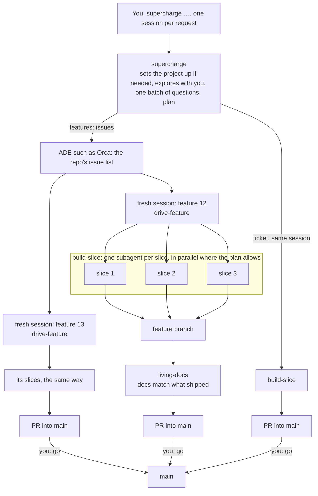

# Supercharge

A small skill bundle for building software with strong LLM agents, in [oh-my-pi (omp)](https://github.com/can1357/oh-my-pi) or [Claude Code](https://code.claude.com).

Made by [Saankofi](https://saankofi.com) and [PO2 Academy](https://www.po2academy.com).

## Philosophy

**Guide how the agent works, not how it does the work.** The skills set direction, boundaries and a definition of done, and leave the technique to the model. The bundle therefore assumes a strong model; weaker models need a more prescriptive process than this one.

### Less is more

The bundle is small on purpose: five skills, a few short docs, one config block. Every line in a skill should change behaviour; a line that changes nothing when deleted gets deleted. Why:

- **Strong models already know the craft.** They can write a test, shape a module and debug a failure. Spelling that out adds nothing, and a fixed recipe overrides judgement that is often better than the recipe.
- **Every line costs attention.** Skill text is loaded on every run and competes with the task. The more a skill says, the less weight each line gets, so the lines that matter get lost among the ones that don't.
- **Process ages; direction doesn't.** Step-by-step instructions written around one model's weaknesses become dead weight, or get in the way, with the next model. Goals, boundaries and a definition of done stay true.
- **You can read all of it.** The whole bundle reads in one sitting, so you know what the agent was told and can see why it did what it did.

The same goes for what the bundle produces. It takes the lightest route that's safe (a one-line fix is just done; only bigger work gets a feature doc), keeps a few short docs rather than a wiki, deletes acceptance tests once they pass, and keeps the test suite fast. Less to maintain, less to drift out of date, less for the next session to read.

### Good engineering by default

Few instructions doesn't mean low standards. Every slice meets the bar a careful senior engineer sets for their own work:

- **Tests first.** One acceptance test per criterion, seen failing, then the inside test-driven until it passes. What stays is the unit tests and one happy-path end-to-end test per core flow, through what users use.
- **Run it for real.** Green tests aren't done: the agent runs the thing end to end, in the browser for a UI.
- **One builder, one independent reviewer.** A different model reviews the diff against the acceptance criteria before the PR, so the builder's blind spots aren't the reviewer's.
- **Small changes, green CI.** Each slice is its own reviewable change, merged only with CI passing, and CI kept within a time budget.
- **Build for what exists.** No compatibility layers for data, users or releases that don't exist yet. Every external service sits behind an interface with a fake, so everything runs offline.
- **Rigour scales with risk.** More edge-case tests and a stricter review where a mistake costs more, not everywhere.
- **Decisions written down.** A decision ledger in each PR, ADRs for what's hard to reverse, and the docs updated as part of done.

### Principles

These run through every skill:

1. **Docs are the current truth.** A few short docs say why and what; code and tests show how. Updating the docs is part of done.
2. **Ask about the business, decide the technical.** Business rules (what gets recorded, money, who can do what, what users see) are never guessed silently. Technical choices are the agent's, recorded as it goes. Architecture and commitments outside the codebase (third parties, cost, data leaving the system, licenses) are proposed as ADRs for the human to accept. Questions come in one batch, each with a default, so `go` answers them all; only a brainstorm, while the direction is still open, is a back-and-forth.
3. **What's written is binding.** Anything the human wrote or approved is a requirement. Fill the gaps; flag conflicts rather than silently "improving" things.
4. **Vertical slices, sized by what they deliver.** Each slice works end to end and has acceptance criteria. The plan marks which slices can be built together, and those are built in parallel; rules they share are settled in the feature doc first, so each slice doesn't invent its own.
5. **Stop only where a human is needed.** Run every other step. At a stop, say exactly what to do and what happens after, so nothing has to be remembered.

## How it works



Each slice: acceptance tests first, built, run for real, reviewed by a different model, PR with green CI. One session per request, which builds a ticket itself; each feature gets a fresh session of its own, one subagent per slice, each in its own worktree. Every issue starts with the command that builds it, so starting it from the ADE's issue list is the whole handoff. You answer one batch of questions and check the plan at the start, and reply `go` at the end; the docs on `main` carry the context between sessions. Without an ADE, it's several omp or Claude Code sessions side by side, started with the issue URLs.

## Install

In omp:

```sh
npx skills add po2studio/supercharge -g -a pi
```

`pi` is omp's upstream, so this installs into `~/.agents/skills`, which omp reads. Leave out `-g` to install into one project's `.agents/skills` instead. Check with `omp read skill://supercharge`; update with `npx skills update -g`.

In Claude Code:

```sh
npx skills add po2studio/supercharge -g -a claude-code
```

This installs into `~/.claude/skills`; leave out `-g` for one project's `.claude/skills`. Check by typing `/supercharge` in a session, or run `/skills`; update with `npx skills update -g`. That's the whole install: no plugin, agent files, settings or hooks, and nothing beyond `git` and `gh`.

Claude Code needs v2.1.283 or later, where auto mode is the starting permission mode. On an older version, or where auto mode isn't the starting mode, start with `claude --permission-mode auto`. Claude Code is supported but untested: it stays that way until a run in it is written up in [`runs/`](runs/).

Installed before `supercharge` replaced `plan-feature`? Remove `plan-feature`, or both skills claim the same requests, then run the install command again to get `supercharge`:

```sh
npx skills remove plan-feature -g -y
```

## Config

A YAML block in a `## Supercharge` section of the project's `AGENTS.md`. `living-docs` writes it when `supercharge` first sets a project up, asking for each key with its default. A key that's still missing is asked for with the next request's questions:

```yaml
risk: medium                 # low | medium | high; a feature doc may override this, with a reason
approve: [plan, merge]       # spec | plan | slice | merge: wait for the human at these points
ci_budget: 5m                # how long CI may take
docs: docs                   # folder for the docs, ADRs and feature docs
```

Missing keys take the defaults.

### `risk`

How costly a mistake would be. It sets the rigour (edge-case tests, how strict the review is) and how readily the agent asks about business rules:

- **`low`:** asks only when it can't go on without an answer.
- **`medium`:** asks where a wrong guess would record wrong data or be hard to undo, for example how currencies are handled.
- **`high`:** asks about any business rule that isn't written down.

### `approve`

Everything runs on its own except the steps listed in `approve`. At each one the agent stops and says what to check, what to reply, and what happens next.

| Value | Stops | You | Then |
|---|---|---|---|
| `spec` | After the feature doc's deliverables and acceptance criteria, before slicing | Check *what* gets built. Reply `go` or say what to change | It plans the slices |
| `plan` | After the slices are planned, before building | Check what gets built and how it's cut. Reply `go` or say what to change | It creates the issues. A ticket is built in the same session; a feature is built once you start its issue in a fresh session |
| `slice` | After each slice, or each batch built together, is built, reviewed and merged into the feature branch | Try it: the stop says how to run it and what to check. Reply `go` or report a problem | It fixes the problem, or starts the next slice |
| `merge` | After every slice is done and the docs are refreshed on the feature branch | Review the one PR (or branch) into `main` and its checklist of human-only checks. Reply `go` | It checks CI, merges into `main` and cleans up the branches and worktrees its agents created. In an ADE such as Orca, it leaves the session's worktree and the branch checked out there for you to remove there. The feature is done |

- **`[plan, merge]` (default):** you check what gets built and how it's cut before any code is written, then see the finished feature. It catches wrong guesses about the product early, which matters most with models that don't ask questions (see [run 4](runs/2026-10-14-receipt-scanner-cheap-models.md)).
- **`[merge]`:** you only see the finished feature.
- **`[slice, merge]`:** test as you go; use it when you want to see each step working on a real device or real data. To see every slice on its own, add "one at a time" to the command.
- **`[]`:** no approvals; the agent merges into `main` as soon as CI passes.

Whatever `approve` says, planning a feature ends its session with a handoff: start the feature issue from Orca, or run `/drive-feature <its URL>`, in a fresh session. You never merge anything yourself: approving is replying `go` in the session.

Small changes skip the feature machinery: a one-line fix is just done, and a single-slice ticket is built in the same session, with its own PR into `main`, which waits for your `go` if `merge` is set.

### `ci_budget`

How long CI may take. When it takes longer, `build-slice` opens an issue to speed it up, if there isn't one open already.

### `docs`

Where the docs, ADRs and feature docs live; every `docs/` path in the skills and in this README means this folder. Leave it as `docs` unless `docs/` already has another job, such as a published docs site; then use something like `docs/supercharge`. `living-docs` checks for this when it asks for `docs`, and offers that as the default. `AGENTS.md` always stays at the repo root. To move the docs later, change `docs` and run `/living-docs`; it moves them and fixes the links.

## Usage

### Setup (once)

**Install** the skills and **set the models** (below; in omp or Claude Code). That's all: the first request in a project sets it up.

### Daily use

1. **Start a new session for each request.** The docs carry the context, so a fresh session loses nothing, and it's cheaper and sharper than one that has run for days.
2. **Run `/supercharge` with what you want, in omp or Claude Code:** an idea, a bug, a change or a feature, from one line to a full spec. For example, `/supercharge the login page fails on an empty email`, or `/supercharge let's explore pricing before we build anything`. In a project that isn't set up yet, it first runs `living-docs`: it reads any existing code, writes `AGENTS.md` (with the [config](#config) block) and the docs, and stops once for you to read them and answer its questions, including every config key that isn't set yet, each with its default; `go` accepts them all. Fix anything wrong in the docs; what you write there is binding. Then it takes your request:
   - **Direction open, or you ask to explore:** it brainstorms with you, back and forth, and writes nothing until you settle the direction. "Not now" ends it with nothing written.
   - **New work:** small things are done directly; a ticket gets one issue and is built in the same session; bigger work gets a feature doc, plus a GitHub feature issue with the slices as its sub-issues. The doc reaches `main` on its own PR, which the agent merges without waiting for `merge`, so a session started from any of the issues can read it.
   - **Planned work** (an issue, a feature doc, "build feature 3, two at a time"): it hands it to `drive-feature` or `build-slice`.
   - **Drifted docs:** it hands them to `living-docs`.
3. **Do what each stop says.** Answer its questions (`go` accepts the defaults), check the plan if `plan` is in `approve`, and approve the PR into `main` with `go`. The agent merges it, and the docs are already current. A feature ends the planning session: start its issue from Orca, or run `/drive-feature <its URL>`, in a fresh session. When a request is finished, start a new session for the next one.

Every issue the bundle creates starts with the command that builds it, so you can start work from Orca's issue list. Filter it with `is:open label:feature` for the features, `is:open label:ready-for-agent -label:slice` for everything you can start at the top level (features and tickets), or `label:feature:NNNN` for one feature and its slices. Orca doesn't show sub-issues or filter on them, so each slice also links to its feature issue.

To build an existing plan:
- **In one session:** start the feature issue from Orca, or run `/drive-feature <feature issue URL or docs/features/NNNN-*.md>`, in omp or Claude Code. It builds the slices the plan marks as buildable together in parallel, and the rest in dependency order, closes each slice's issue as it merges, and the final PR closes the feature issue. To check as you go, or to build fewer at once, add a limit in plain words. It stops after each batch on the feature branch, and `go` starts the next. For example:
  ```
  /drive-feature docs/features/0003-csv-export.md build 3 slices, then stop
  /drive-feature docs/features/0003-csv-export.md at most 2 at once
  /drive-feature docs/features/0003-csv-export.md one slice at a time, I'll test each on my phone
  /drive-feature docs/features/0003-csv-export.md build only slice 2
  ```
- **One slice or ticket per session** (for example, several sessions side by side, in omp or Claude Code): start its issue from Orca, or run `/build-slice <issue URL>`. With no feature branch, each gets its own PR into `main` that closes its issue, merged on your `go`. Pick slices the feature doc marks as buildable together. When the last slice of a feature merges, its stop tells you to start the feature issue from Orca: it skips the finished slices, does only the finish (docs, `living-docs`, status), and its PR closes the feature issue. After a big change made outside the bundle, run `/living-docs` to bring the docs back in line.

## Skills

| Skill | Does |
|---|---|
| `supercharge` | The entry point for any request: sets the project up, brainstorms, triages, then a ticket or `docs/features/NNNN-*.md` plus a feature issue with its slices as sub-issues, and hands planned work to `drive-feature` or `build-slice` |
| `living-docs` | Creates or refreshes `AGENTS.md` and `docs/{BUSINESS,PRODUCT,ARCHITECTURE,DESIGN}.md` (BUSINESS and DESIGN are optional) |
| `adr` | Records a decision in `docs/adr/NNNN-*.md` |
| `build-slice` | Builds one slice to done: tests, end-to-end check, review, PR, green CI, docs updated |
| `drive-feature` | Runs `build-slice` across a feature's slices, then reports once |

Each skill works on its own; `supercharge` and `drive-feature` start the others, and otherwise they coordinate only through the files above and their GitHub issues.
Execution uses omp's built-in features (`task`, the `reviewer` agent, `browser`, the `github` tool), plus `gh` for issues, which the `github` tool can't create; in Claude Code it uses subagents, a headless browser and `gh`. If one is missing, the skill uses an equivalent, or stops and says so. No equivalent replaces a fresh subagent (not a fork) or a reviewer on a different model.

## Models

There are three jobs, and they need different things:

- **Planning** (`supercharge`, `living-docs`): judgement about the business, such as which questions to ask, safe defaults, and checking facts. It uses few tokens, so use the strongest model you have.
- **Building** (`build-slice`): good technical judgement. It uses most of the tokens, so this is where a cheaper model pays off.
- **Reviewing** (omp's `reviewer` agent): an independent check. Always a different model from the builder, ideally from a different company. It's cheap.

Each job runs on an omp model role: the session (planning and driving) on `default`, builders (omp's `task` agent) on `task`, and the reviewer on `slow`. omp's small jobs (`scout` searches, session titles) run on `smol`. Set them in `~/.omp/agent/config.yml` (check with `omp config get modelRoles`):

```yaml
modelRoles:
  default: anthropic/claude-opus-5.5     # plans and drives
  task: anthropic/claude-sonnet-5.5      # builds
  slow: openai-codex/gpt-6.1-sol         # reviews
  smol: anthropic/claude-haiku-5.5       # scouts, titles
```

Without `task`, builders run on `default`; without `smol`, so do the small jobs, at the planning model's price. Keep `task` and `slow` different. On a subscription, choose by quota rather than price: a cheaper builder still saves most of it, because building uses most of the tokens.

**In Claude Code** there are no model roles: the session runs on the model you pick (`/model`), builders on `sonnet`, and the reviewer on a different Claude model (`opus` for a `sonnet` builder, otherwise `sonnet`). The cross-company reviewer is omp-only. If no such reviewer can be started, `build-slice` stops and says so.

Tested in [`runs/`](runs/) (✓ good, ✗ not good enough, ? untested, – not worth testing for that job; prices per million tokens in/out on OpenRouter, October 2026). The frontier models (Fable, Opus, Astra, Sol) qualify for every job without a run of their own: they're at least as strong as the models that passed.

| Model | In / out | Plan | Build | Review |
|---|---|---|---|---|
| `anthropic/claude-fable-5.1` | $10 / $50 | ✓ | ✓ | ✓ |
| `anthropic/claude-opus-5.5` | $4 / $20 | ✓ | ✓ | ✓ |
| `anthropic/claude-sonnet-5.5` | $2 / $10 | ? | ? | ? |
| `openai/gpt-6-astra` | $10 / $50 | ✓ | ✓ | ✓ |
| `openai/gpt-6.1-sol` | $2 / $10 | ✓ | ✓ | ✓ |
| `z-ai/glm-5.3` | $0.07 / $1.40 | ✗ | ✓ | ? |
| `moonshotai/kimi-k3.1-pro` | $2 / $10 | ? | ? | ? |
| `moonshotai/kimi-k3` | $0.24 / $10.80 | ✗ | ? | ✓ |
| `deepseek/deepseek-v4-pro` | $0.96 / $1.91 | ? | ? | ? |
| `qwen/qwen3.8-max-0902` | $2 / $6 | ? | ? | ? |

Proven so far: **Opus plans, GLM 5.3 builds, GPT-6.1 Sol or Kimi K3 reviews**, for about $6 for a small MVP. On a real 5-day project with Opus building, building was 70% of the cost. Cheap models plan badly: they fill business gaps with silent defaults and state unchecked facts. Kimi K2.7 Code couldn't drive the bundle at all ([run 4](runs/2026-10-14-receipt-scanner-cheap-models.md)). The smallest tiers (Haiku, GPT Luna, the Flash models) are untested and probably too small to build; they suit `smol`.

Ideas borrowed from OpenSpec, BMAD, Matt Pocock's skills, Compound Engineering, Spec Kit, Superpowers and cc-sdd.

## Commercial support

Using Supercharge at your company? We offer commercial support, extra tooling and managed spending for teams. Email us at [info@po2studio.com](mailto:info@po2studio.com).

## License

MIT. See [LICENSE](LICENSE).
